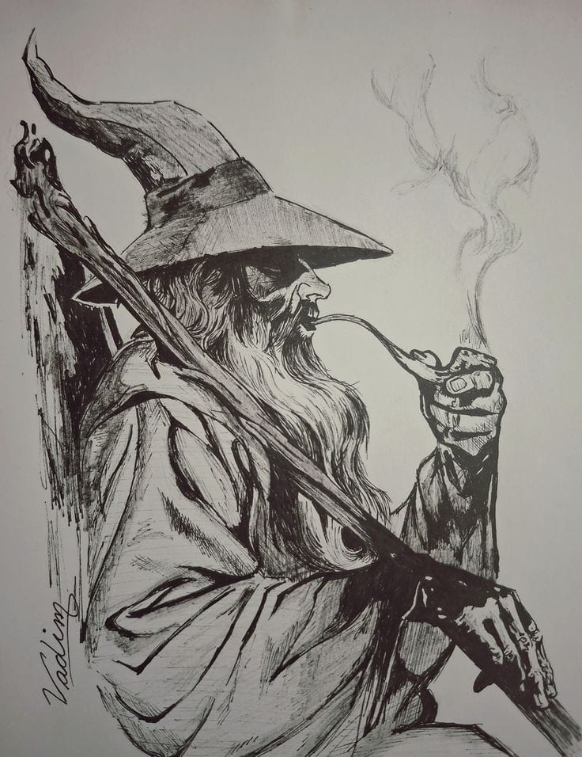

<pre>ADS student · Back-end dev · Homelab tinkerer Building eSIC · HR Portal · Project Atena (AI agents) Exploring cybersecurity · Go · Rust Off the clock: Dostoevsky · Heavy metal · Coffee at 2am</pre>

 

<table>
<tr>
<td valign="top" width="50%"></td>
<td valign="top" width="50%">
  

<b>Languages &amp; Tools</b> what I build, deploy and break things with

</td>
</tr>
</table>

<table>
<tr>
<td valign="middle">

<pre>
        *              .            (  )          .          *
   .          *                      ''       *         .
                       /\                            .
          /\          /  \     /\        _|_                 *
         /  \   /\   /    \   /  \      |___|        .
        /    \ /  \ /  /\  \ /    \     | o |                  .
       /  /\  \    /  /  \  \  /\  \    |   |   /\
      /  /  \  \  /  /    \  \/  \  \   | o |  /  \     /\
     /  /    \  \/  /      \  \   \  \  |   | /    \   /  \
  __/__/______\__\_/________\__\___\__\_|___|/______\_/____\__
     ~~~    ~~~~      ~~~      ~~~~       ~~~     ~~~~    ~~~
            . . . the road goes on, and so do I . . .
</pre>

</td>
<td valign="middle" width="35%"></td>
</tr>
</table>

<b>Starred topics</b>

**[📌 ](https://github.com/kaincore?tab=stars)**

No starred topics

